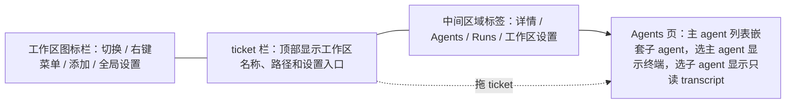
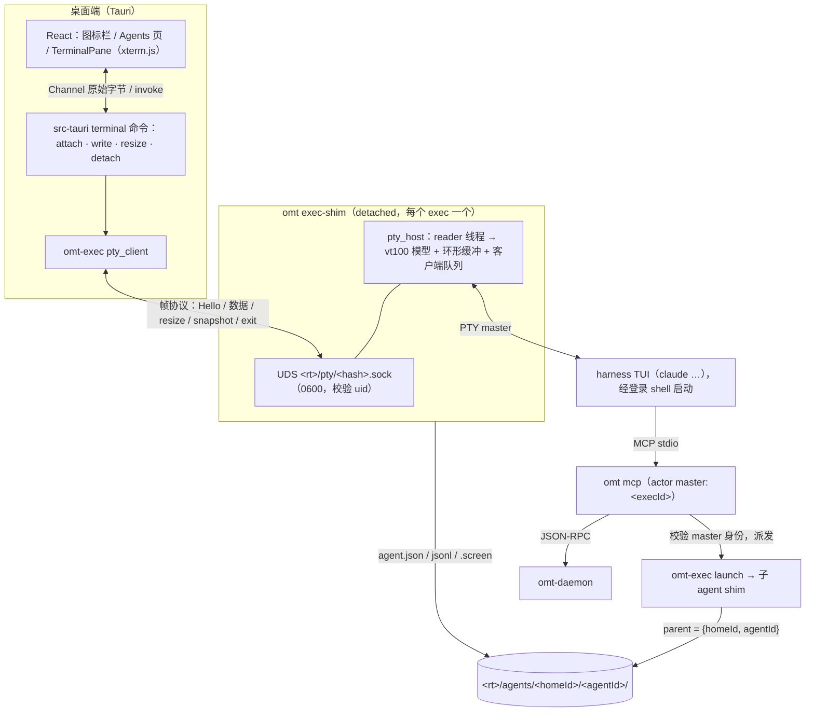
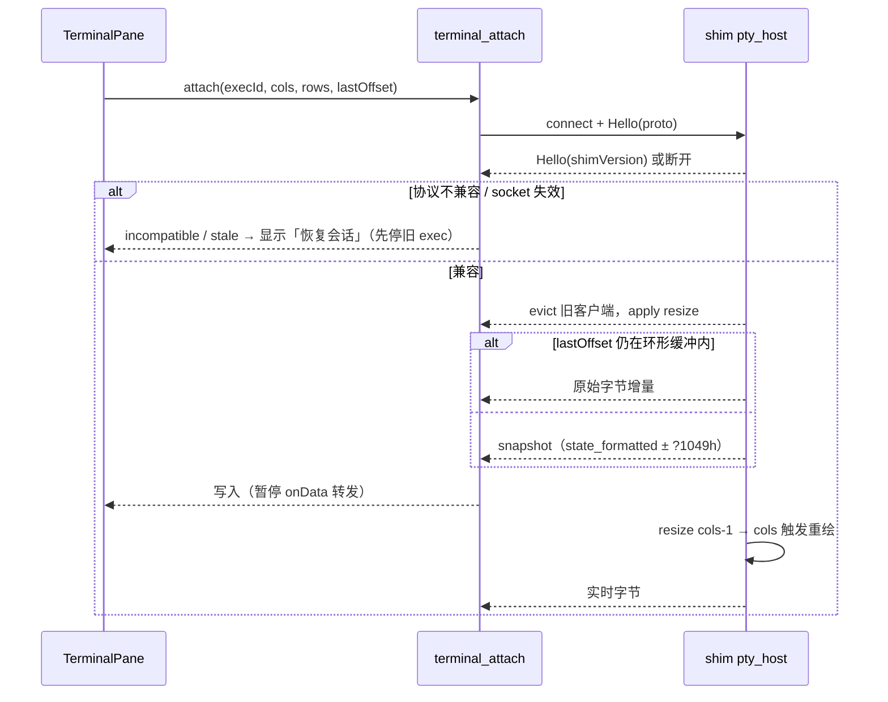
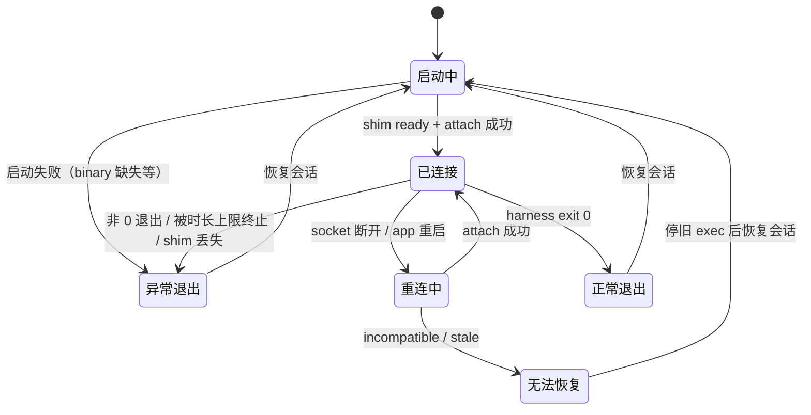
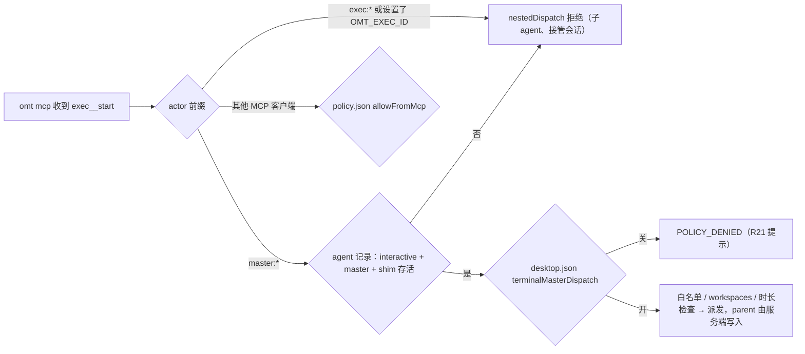
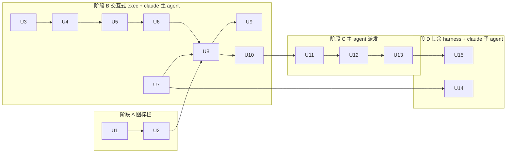

# Desktop Embedded Terminal and Workspace Rail - Plan

## Goal Capsule

- **Objective**：桌面端内嵌终端，作为与主 agent 日常对话、派发 ticket 的入口；同时用左侧工作区图标栏替换右上角的工作区切换弹窗。
- **Authority hierarchy**：
  1. Product Contract 的 R 决定产品行为；
  2. Planning Contract 的 KTD 决定实现机制，但不能越过它所引用的 R；
  3. Implementation Units 不得推翻上面两者。

  omt self-hosting、通用 worktree 隔离、多目录工作区不在本期范围，只作为上下文出现。
- **Execution profile**：Deep。共 15 个单元，分 A–D 四个阶段（见 Sequencing）。在从 `main` 新建的分支上、独立 worktree 里实现，不在 `feat/harness-benchmark` 上动代码。
- **Stop conditions**：遇到以下情况先停下来，向用户说明后再继续：
  - 某个 session-settled 决策被证明做不到，例如脱离进程的 PTY 重连无法恢复屏幕，或者 claude 的 `--settings` hook 无法上报会话 ID；
  - spec v2 会破坏正在运行的 exec；
  - KD-E9 检查失败；
  - 需要改动 Product Contract 的范围。
- **Tail ownership**：按仓库约定，由执行方（`ce-work`）负责提交、PR 和 CI。
- **Open blockers**：无。主 agent 派发所依赖的子项目 2（CLI / MCP 本地工具族 + policy）已于 2026-10-23 完成。
- **前置条件（开工前）**：子项目 1、2 和 findings log §49–§63 的修复目前只在 `feat/harness-benchmark` 上（截至 2026-10-25 比 `main` 多 99 个提交），`main` 上还没有 `crates/omt-exec/src/{policy,grants,control}.rs`、`crates/omt-runtime/src/{local_tools,local_impl}.rs` 等本计划引用的文件。先把 `feat/harness-benchmark` 合入 `main`，再按 Execution profile 从 `main` 开分支；否则新分支缺少执行面和 MCP 派发能力。

---

## Product Contract

### Summary

桌面端最左侧新增工作区图标栏，用来切换和管理工作区；它取代右上角的切换弹窗。Agents 页可以打开内嵌终端：在工作区目录中启动 claude、pi、omp 或 opencode 的原生 TUI。终端会话就是主 agent，它派发的子 agent 嵌套显示在它下面；关闭桌面端后，会话继续运行。

### Problem Frame

现在要和 harness 对话，只能离开 omt 去外部终端。桌面端唯一能打开终端的地方是 Harnesses 设置里的登录入口（`apps/desktop/src-tauri/src/harness.rs` 的 `harness_open_login`，用 osascript 打开 Terminal.app），它只用于登录。Agents 面板只能只读地查看桌面端派发出去的 exec。用户想和主 agent 讨论需求、让它把 ticket 派给子 agent，却没有一个在 omt 内部、能看到父子关系的入口。

执行面设计原计划分两步接入主控：先用 hook 附着外部启动的 Claude Code（子项目 3，KD-E6）；再由 omt 拉起主控（子项目 5，KD-E7）。后者暂缓的理由是「headless 主控不能在终端对话，交互形态需另议」（`docs/plans/2026-10-20-0802-feat-omt-exec-plane-orchestration-design.md` §3.8）。xterm.js spike 已经证明，在桌面端内嵌原生 TUI 可行，所以这个交互形态问题现在有了答案。

工作区切换藏在右上角的弹窗里，和主流 agent 界面「左侧列工作区」的习惯不一致。终端按工作区归属，入口位置也要跟着布局一起定。

### Actors

- A1. 用户：在终端里和主 agent 对话，偶尔接管子 agent 的会话。
- A2. 主 agent：在终端会话中运行的 harness，注入了 omt MCP，可以派发 ticket。
- A3. 子 agent：由主 agent 派发、执行单个 ticket 的 harness exec。

### Key Decisions

- **内嵌 xterm.js，直接运行 harness 的原生 TUI；关闭桌面端后会话继续运行。** 原生 TUI 的能力强于自建对话面板。spike 已验证中文输入法、拖放、权限确认和斜杠命令。Governs R10, R13, R15。(session-settled: user-approved — chosen over 外部终端 / 只做对话面板: 原生 TUI 能力更强且 spike 已验证可行)
- **终端会话按「交互式 exec」承载：由 detached shim 持有 PTY，记录进现有的 agent / exec 存储。** 只有一套记录，Agents 页不用合并两个数据源，也不引入 tmux 依赖。Governs R13, R17, R18。(session-settled: user-directed — chosen over 独立终端实体（单独的会话记录）/ tmux 承载: 单一记录源且无新依赖)
- **工作区图标栏并入本期。** 主 agent 按工作区归属，终端入口的位置取决于布局。Governs R1–R9。(session-settled: user-approved — chosen over 单独一份需求: 终端入口位置依赖布局)
- **布局采用「图标栏 + 终端放在 Agents 页」。** 对现有布局改动最小，主 agent 和子 agent 集中在一处。Governs R1, R10, R19。(session-settled: user-directed — chosen over 会话挂在侧栏工作区下的 Codex 式布局 / 终端停靠底部的 VS Code 式布局: 改动最小，主、子 agent 同处一页)
- **设置提供三个入口：右键图标和 ticket 栏标题旁的 ⚙ 打开工作区设置，图标栏底部的 ⚙ 打开全局设置。** 右键无需先切换工作区；标题栏补足图标栏只显示缩写的不足。Governs R4–R6, R8。(session-settled: user-approved — chosen over 只留其中一两个入口: 右键免切换、标题栏补全名称)
- **终端会话是完整的主 agent。** 注入 omt MCP，子 agent 嵌套在它下面显示。Governs R17–R19。(session-settled: user-approved — chosen over 只能聊天的纯终端: 终端定位为主 agent 入口)
- **内嵌终端取代子项目 3（hook 附着），并以交互形态落地方案 A。** 执行面设计中 KD-E6、KD-E7 的取舍由本期改写，hook 附着暂缓。(session-settled: user-approved — chosen over 先做 hook 附着: 内嵌终端覆盖了附着要解决的交互场景)
- **拖入 ticket 时插入 ID 引用，不插入文件路径。** Governs R16。(session-settled: user-approved — chosen over 拖入 ticket 文件路径: ID 是 omt MCP 能直接解析的引用)
- **派发仍由 policy 管。** 终端主 agent 的派发授权未开启时，打开终端给出提示。Governs R21, R27。(session-settled: user-approved — chosen over 终端会话绕过 policy: 保留 KD-E5 的派发闸门)
- **只能接管未运行的子 agent，接管后 ticket 状态由用户裁决。** Governs R22, R23。(session-settled: user-approved — chosen over 运行中也可进入 / omt 自动改状态: 避免两个输入源同时驱动同一会话)
- **四个 harness 的终端和只读 transcript 都要支持，允许分阶段交付，claude 先做。** Governs R20, R25。(session-settled: user-approved — chosen over 只支持 claude: 主 agent 的 harness 由用户选择)
- **时长上限分三项，全部可配置。** 每个上限都由用户掌控，不对交互式会话写死豁免。Governs R24。(session-settled: user-directed — chosen over 交互式 exec 直接不受上限约束: 用户要求上限可配置)
- **多目录工作区本期不做，只做三处低成本预留：工作区有独立显示名、终端 cwd 写成「主目录」、父子关联带 homeId。** 以后无论选哪种多目录模型，都不用推翻本期的布局和数据关联。Governs R7, R11, R18。(session-settled: user-approved — chosen over 先定多目录模型 / 完全不预留: 预留成本低，且不锁定模型)
- **升级后如果连不回原会话，提示用户恢复该 harness 会话。** Governs R13。(session-settled: user-approved — chosen over 直接报错丢弃会话: 会话历史仍在 harness 侧)
- **终端默认使用 DOM 渲染器并开启 `CLAUDE_CODE_NO_FLICKER`。** spike 中 WebGL 在 resize 时闪烁明显，DOM 加 NO_FLICKER 输出时不闪。Governs R15。(session-settled: user-approved — chosen over WebGL 渲染器: spike 实测闪烁更少)

### Requirements

**工作区图标栏与设置**

- R1. 桌面端最左侧显示工作区图标栏，每个已打开的工作区对应一个图标，点击即切换。它取代右上角的切换按钮和弹窗。
- R2. 图标显示工作区显示名的缩写，悬停时显示全名；有运行中的终端会话时，图标上用角标标出数量。
- R3. 图标栏提供「＋ 添加工作区」，沿用现有的目录选择和「已知未开」流程。
- R4. 右键工作区图标弹出菜单，包含：工作区设置、在此工作区打开终端（仅有项目目录的工作区，见 R12）、在 Finder 中显示、从列表移除。无需先切换到该工作区即可操作。
- R5. ticket 栏顶部显示当前工作区的显示名和路径，旁边的 ⚙ 打开当前工作区的设置。
- R6. 工作区设置作为中间区域的一个标签页，与详情、Agents、Runs 并列。本期包含：路径、重建索引、在 Finder 中显示、从列表移除。
- R7. 工作区有独立于路径的显示名。本期默认取目录名，不提供改名。
- R8. 图标栏底部的 ⚙ 打开全局设置，内容是 Daemon、DSH 集成、Harnesses、派发策略。原设置页里的 Workspaces 列表移到图标栏。顶部原有的 Tickets / Runs / 设置标签去掉：Runs 进入中间区域的标签，设置进入图标栏。
- R9. 「从列表移除」只把工作区从桌面端的已打开列表中移除，不删除 `.omt` 目录和其中的 ticket。工作区里还有运行中的终端会话时，先提示用户确认。
- R32. 移除有运行中会话的工作区时，提供「停止会话并移除」和「移除但保留运行」两个选项；退出确认框仍列出被移除工作区里的会话。

**内嵌终端**

- R10. Agents 页的列表顶部提供「打开终端」，从已启用的 harness 中选择一个，打开后作为新的主 agent 会话。
- R11. 终端在工作区的主目录中启动 harness，使用用户登录 shell 的环境。本期主目录就是包含 `.omt` 的项目目录。
- R12. 没有项目目录的工作区（全局 home）不提供任何「打开终端」入口。
- R13. 关闭桌面端后终端会话继续运行，重新打开桌面端时自动连回。连不回时（例如升级后），提示用户恢复该 harness 会话。恢复前先判断原 shim 或 harness 是否仍存活；仍存活时先停止原 exec，确认退出后再续接 harness 会话。
- R14. 同一个工作区可以同时开多个终端；每个主 agent 同一时间最多只有一个活着的交互式 exec。
- R15. 终端完整支持原生 TUI 交互：中文输入法、复制粘贴、Ctrl+C 中断、Esc、斜杠命令补全、权限确认。Shift+Enter 插入换行；调整窗口大小时做防抖，避免整屏重绘造成闪烁。
- R16. 从 ticket 栏把 ticket 拖入终端时，在 harness 的输入框中插入该 ticket 的 ID 引用（ID 加标题）。插入前去掉标题中的控制字符（C0/C1，包括 CR、LF、ESC），并以一次 bracketed paste 写入；拖放本身从不提交输入。
- R26. 交互式 exec（新开的主 agent 终端和接管会话）启动时不带 harness 的无人值守参数，使用 harness 自身的交互审批模式。没有审批层的 harness（pi）在打开终端时标明这一点。
- R28. 主 agent 面板有明确的状态：启动中、已连接、重连中、正常退出、异常退出或被时长上限终止、无法恢复。每个状态下面板、Agents 列表行和图标栏角标的显示保持一致。已结束的会话保留最后一屏只读输出，并提供「恢复会话」。
- R33. 退出桌面端的确认框里，终端会话单独计数；「全部停止」默认不停止终端会话，由单独的勾选项决定是否一并停止。

**主 agent 与子 agent**

- R17. 终端会话就是一个主 agent：注入 omt MCP，作为一条 agent 记录显示在 Agents 列表中。
- R18. 主 agent 派发的子 agent 嵌套显示在它下面。父子关联要能定位到另一个工作区里的 agent（关联里同时带 homeId 和 agentId）。父子关联由 omt 根据发起派发的主 agent 会话身份自动写入，不依赖模型在派发参数里自行传入。
- R19. 在 Agents 列表中选中主 agent，显示可交互的终端；选中子 agent，显示只读 transcript。
- R20. 子 agent 能显示只读 transcript，按 R25 分阶段交付：第一阶段交付 claude；pi、omp、opencode 在后续阶段交付，验收前先完成各自的 spike 验证。
- R21. 从终端发起的派发受派发策略约束。打开终端时，如果终端主 agent 的派发授权未开启，提示用户并指向派发策略设置。
- R27. 派发策略为内嵌终端主 agent 单独设派发授权开关，按主 agent 的会话身份识别，不依赖全局 `allowFromMcp`。提示中说明：打开全局 MCP 派发会让其他 MCP 客户端也能发起无人值守的 exec。
- R29. 主 agent 可以把 ticket 派发到图标栏里的其他工作区；目标工作区尚未在 daemon 打开时自动打开。
- R30. 停止主 agent 时，如果它有运行中的子 agent，询问是否一并停止；选否时子 agent 继续运行，仍嵌套在已结束的主 agent 下。
- R22. 子 agent 不在运行时，用户可以进入它的会话：在该子 agent 自己的面板里从只读 transcript 切换为交互终端，续接该 harness 会话；它在列表中仍留在原主 agent 下，行上显示「接管中」。子 agent 运行中时，这个入口不可用。接管期间该子 agent 视为忙碌：任何以它为目标的派发（包括 MCP 续跑）都被拒绝，直到接管终端退出且用户完成 R23 的状态裁决。
- R23. 接管会话结束后，桌面端请用户为对应 ticket 选择状态；omt 不自动改动 ticket 状态。

**时长上限**

- R24. 全局设置的派发策略中有三项时长上限，都可以配置，都按总运行时长计算，到时终止 exec：
  - 交互式终端，默认不限时；
  - 桌面端派发，默认 120 分钟，现在是写死的值；
  - CLI / MCP 派发，沿用现有的 `maxDurationSec`，默认 1800 秒。
- R31. 交互式会话设置了时长上限时，到期前 5 分钟在终端面板上提示。

**Harness 覆盖**

- R25. claude、pi、omp、opencode 都能在内嵌终端中作为主 agent 运行，允许分阶段交付，claude 先做。
- R34. claude 能作为子 agent 被派发后，claude 加入 policy 的默认 harness 白名单。

### Key Flows

- F1. 和主 agent 讨论需求并派发
  - **Trigger:** 用户在 Agents 页点「打开终端」，选择 claude。
  - **Actors:** A1, A2, A3
  - **Steps:** 终端在工作区主目录中启动 claude；用户从 ticket 栏拖入 ticket 进行讨论；主 agent 经 omt MCP 派发 ticket；子 agent 出现在主 agent 下方；用户点开子 agent 查看只读 transcript。
  - **Covered by:** R10, R11, R16, R17, R18, R19, R21, R27
- F2. 关闭桌面端后回来
  - **Trigger:** 终端会话运行中，用户退出桌面端，之后重新打开。
  - **Actors:** A1, A2
  - **Steps:** 会话在后台继续；重新打开后，Agents 页里的主 agent 仍显示为运行中，选中即连回终端；连不回时提示恢复会话。
  - **Covered by:** R13, R28
- F3. 接管子 agent
  - **Trigger:** 子 agent 执行结束（或被停止），用户想直接和它对话。
  - **Actors:** A1, A3
  - **Steps:** 选中该子 agent，点「进入会话」；它的面板切换为交互终端，续接它的 harness 会话；用户退出终端后，面板切回 transcript，桌面端请用户为 ticket 选择状态。
  - **Covered by:** R22, R23, R26

### Acceptance Examples

- AE1. **Covers R12.** Given 当前工作区是全局 home，when 用户右键它的图标或打开 Agents 页，then 看不到「打开终端」。
- AE2. **Covers R14.** Given 主 agent M1 的终端在运行，when 用户再次「打开终端」，then 得到一个新的主 agent M2，而不是在 M1 上再开一个 exec。
- AE3. **Covers R21, R27.** Given 终端主 agent 的派发授权未开启，when 用户打开终端，then 终端照常启动，同时显示提示，并给出进入派发策略设置的入口。
- AE4. **Covers R22.** Given 子 agent 正在运行，when 用户选中它，then 「进入会话」不可用，只显示只读 transcript。
- AE5. **Covers R13.** Given 升级桌面端后某个终端会话连不回，when 用户选中该主 agent，then 显示「恢复会话」；确认后，若原 shim 仍存活先将其停止，再续接原 harness 会话。
- AE6. **Covers R24.** Given 交互式终端上限保持默认，when 会话运行超过 120 分钟，then 会话不会被终止。
- AE7. **Covers R9, R32.** Given 工作区里有运行中的终端会话，when 用户选择「从列表移除」，then 提供「停止会话并移除」和「移除但保留运行」两个选项；无论选哪个，都不删除 `.omt` 目录。

### Scope Boundaries

- 多目录工作区本身（以后单独 brainstorm，决定是「工作区 = 一组 home」还是「一个 home 挂多个目录」）。
- hook 附着外部启动的 Claude Code（原子项目 3），暂缓。
- 通用 worktree 隔离、omt self-hosting，各自单独 brainstorm。
- 把 ticket 拖出到外部应用。
- 工作区改名、「终端默认 harness」设置。

<!-- ce-section: work-relationships -->
### How This Work Fits Together

本文档只负责内嵌终端和工作区图标栏。下面列出的其他工作是对现状的理解，不是已承诺的路线图。

- 执行面子项目 1、2：已完成，本期依赖它们。
  - Depends on 子项目 2 的 MCP 派发能力，主 agent 派发 ticket 靠它。
- 执行面子项目 3（hook 附着）：由本期取代，暂缓。
- 执行面子项目 5（omt 拉起主控）：本期以交互形态落地。设计文档 §3.8 的 headless 形态 Still to decide。
- 执行面子项目 4（编排文件与可视化）：Can proceed independently of 本期；它的可视化之后会挂在本期的主、子 agent 层级上。
- 多目录工作区：Still to decide 采用哪种模型；本期的 R7、R11、R18 是为它做的预留。
- omt self-hosting、通用 worktree 隔离：Can proceed independently of 本期。

### Dependencies / Assumptions

- 现有 shim 不持有 PTY：harness 子进程只接管道，stdin 为空（`crates/omt-exec/src/executor.rs`）。交互式 exec 的 PTY 承载需要新做，不是复用现有能力。
- 现有 exec 机制对交互式会话有几处需要豁免或调整：时长上限看门狗、30 秒启动窗口、按行解析 jsonl 的输出流、只支持 ticket / run 的启动目标，以及 maxConcurrent 并发计数（`check_capacity` 目前统计全部活动 exec；交互式 exec 不应占用派发名额，退出确认框仍单独计数）。per-agent busy 规则（`crates/omt-exec/src/agents.rs`）对交互式 exec 不做豁免。
- 现有的嵌套派发闸门（`OMT_EXEC_ID` 环境变量加 `--actor exec:*` 的 MCP 身份，见 `crates/omt-runtime/src/mcp.rs` 与 `local_impl.rs`）会拦下所有 exec 进程的派发。主 agent 的交互式 exec 需要一个独立身份，凭它暴露本地工具并允许派发和停止 exec；它派出的子 agent 和接管会话仍受闸门约束。
- `AgentRecord.parent_agent_id` 已经存在，但只记 agentId（`crates/omt-exec/src/agents.rs`），且目前由模型在 `exec__start` 参数里自行提供（`crates/omt-runtime/src/local_tools.rs`）。R18 要在其中加入 homeId，并改为由 omt 自动写入。
- claude 目前不在 harness 注册表中（`crates/omt-harness/src/harness.rs` 只有 opencode / omp / pi），MCP 注入只支持这三个（`crates/omt-exec/src/mcp_injection.rs`），policy 的 harness 白名单也不接受 claude。claude 先做意味着先完整接入 harness：descriptor、探测与启用、经 `--mcp-config` 注入 MCP、policy 白名单、会话 ID 记录，以及只读 transcript 需要的流 adapter（参照执行面设计 §3.8）。
- 交互式 exec 要跟踪 harness 当前的会话 ID：用户在 TUI 内 `/clear` 或 `/resume` 会切换会话（claude 可在启动时注入 SessionStart hook 上报）。R13、R22 恢复时使用最近观察到的会话 ID。
- 桌面端目前没有「在 Finder 中显示」「从列表移除」或重建索引的入口。daemon 有 `home/reindex`（admin 族），但没有移除工作区的 RPC。
- Claude Code CLI 支持 `--session-id`、`--resume`、`--mcp-config`、`--add-dir`（2.1.310 实测）。pi、omp、opencode 的续接方式和内嵌终端表现尚未在 spike 中验证。
- spike（Tauri 2 + xterm.js 6.0.0 + portable-pty 0.9，仅测试了 claude）结论：中文输入法没有丢字；拖入 ticket 后插入的内容不会被折叠；Shift+Enter 默认不换行；resize 时有闪烁。

### Outstanding Questions

**Deferred to Implementation**

- pi、omp、opencode 的会话预分配或会话发现方式，以及 omp 主 agent 的 MCP 注入方式（`--profile` 还是扩展），在 U15 的 spike 中定案（KTD20）。
- 跨工作区派发时临时 admin grant 的具体接法，在 U12 中按 `grants.rs` 现有模式落地（KTD13）。
- 没有客户端连接时，TUI 的启动探测（DA1、DSR）是否需要由 shim 代为应答，由 U5 的 e2e 测试决定。

### Sources / Research

- `docs/plans/2026-10-20-0802-feat-omt-exec-plane-orchestration-design.md`：KD-E5 至 KD-E9、§3.7（附着）、§3.8（方案 A）、§7（子项目拆分）。
- `crates/omt-exec/src/executor.rs`：`DEFAULT_MAX_DURATION`（桌面端 120 分钟）、`workspace_root_of`（cwd 推导）。
- `crates/omt-exec/src/policy.rs`：`allowFromMcp` 默认 false，`maxDurationSec` 默认 1800，只作用于 CLI / MCP。
- `crates/omt-exec/src/layout.rs`：agent 存储按 `agents/<homeId>/<agentId>/` 组织。
- `apps/desktop/src/App.tsx`、`apps/desktop/src/WorkspaceSwitcher.tsx`、`apps/desktop/src/SettingsPanel.tsx`：现有顶栏、切换弹窗和设置分段。
- 已知风险：xterm.js 在 macOS 上的 CJK 输入法问题（xterm.js issues #6144、#6089、#6112）在 spike 中没有复现，正式实现应保留输入法回归用例。

---

## Planning Contract

**Product Contract preservation**：changed: R29–R34 新增（计划范围确认时用户认可的边界默认值），AE7 改为 Covers R9, R32；Outstanding Questions 中的计划期问题已在本节 KTD 中解决并就地改写；评审暂缓的「图标栏重名、排序和异常状态规则」由 KTD14 解决，暂缓条目已移除。其余条目未改。

### Key Technical Decisions

- KTD1. **shim 用 portable-pty 0.9 持有 PTY。** 子进程由 portable-pty 完成 `setsid` 和 `TIOCSCTTY`，进程组号等于 pid，现有按进程组 kill 的路径继续可用。writer 在 shim 生命周期内只取一次、始终持有（drop 会向 TUI 写入 `\n^D`）。`child.wait()` 线程是退出的唯一权威，不以 reader EOF 判断退出（孙进程可能继续持有 slave）。停止顺序为对进程组发 SIGHUP、TERM，最后 KILL，让 harness 有机会保存会话。spike 已用 portable-pty 0.9 跑通 claude；手写 `libc::openpty` 虽然不加依赖，但要自己处理控制终端和信号复位。Governs R13, R15。
- KTD2. **桌面端与 shim 之间用每个 exec 一个 Unix socket 双向通信。** socket 放在短路径 `<rt>/pty/<execId 哈希前 12 位>.sock`，避开 macOS `sun_path` 104 字节上限。目录权限 0700，socket 0600，连接时用 `getpeereid` 校验对端 uid。帧格式为 1 字节类型、4 字节长度、载荷；PTY 字节走二进制数据帧，控制消息（hello、resize、exit、snapshot 起止、cap 预警、evicted）走小 JSON 帧。连接后第一帧是 `Hello{proto, shimVersion, execId}`，协议不兼容时客户端报告 incompatible，R13 据此进入恢复流程。同一时间只允许一个客户端，新连接踢掉旧连接，并由新客户端决定窗口大小；被踢的客户端收到 evicted，不自动重连。Governs R13。
- KTD3. **shim 内维护终端屏幕模型，用于重连时恢复屏幕。** reader 线程无论是否有客户端都持续读取 PTY，每块数据同时送进 `vt100` 0.18 解析器、1 MiB 原始字节环形缓冲（偏移单调递增）和当前客户端的有界队列；客户端跟不上时丢弃它的积压，改发快照，从不阻塞 PTY。重连时客户端带上最后偏移：偏移仍在环形缓冲内就补发原始字节，否则发快照（`state_formatted`，处于备用屏时补 `ESC[?1049h`），再接实时字节。快照之后用 cols−1、cols 两次真实尺寸变化强制 TUI 重绘。shim 退出时把最后一屏写入 `<execId>.screen`（0600），供 R28 的只读最后一屏使用，随 agent 一起删除。单纯回放原始字节对全屏 TUI 不完整：环形缓冲被截断后会丢失模式设置序列。(session-settled: user-approved — chosen over 只回放原始字节: 全屏 TUI 截断后丢模式设置) Governs R13, R28。
- KTD4. **交互式 exec 是 LaunchSpec 的一种模式。** `LaunchSpec` 增加 `mode`（headless，或 interactive 加初始 cols/rows）和 `role`（master 或 takeover），`SPEC_SCHEMA_VERSION` 升到 2，旧 shim 读到会精确匹配失败并拒绝。`LaunchTarget` 增加不挂 ticket 和 run 的 `Workspace` 目标，`DispatchPlan.run_id` 和 `ExecStartOutcome.run_id` 改为可选。`ExecRecord` 增加 `mode`、`role`、`harnessSessionRef`、`pendingStatusDecision`，全部 serde default，旧记录照常可读。per-agent busy 规则保持不变，交互式 exec 同样受它约束。Governs R10, R14, R22。
- KTD5. **三项新设置写进桌面端自有的 `<rt>/exec/desktop.json`，不改 `policy.json`。** 字段为 `desktopMaxDurationSec`（默认 7200）、`interactiveMaxDurationSec`（默认 null，表示不限时）和 `terminalMasterDispatch`（默认 false）。文件缺失或损坏时回落到默认值并在派发策略页显示警告，绝不阻塞桌面端启动 exec。时长在 `ExecutionManager`、`LaunchSpec`、`LaunchRequest` 中一律以 `Option<Duration>` 传递；用 `Duration::MAX` 当哨兵值会让看门狗计算 `Instant` 时 panic。改了的上限只对新 exec 生效，设置页文案写明这一点。(session-settled: user-approved — chosen over 新字段写进 policy.json: policy.json 拒绝未知字段，旧版 omt CLI 读到会让全部 CLI/MCP 派发失败) Governs R24, R27。
- KTD6. **主 agent 使用独立身份，服务端校验。** 主 agent exec 不再设置 `OMT_EXEC_ID`，改为设置 `OMT_MASTER_EXEC=<homeId>/<agentId>/<execId>`，MCP actor 用 `master:<execId>`（不超过 daemon 的 64 字符 actor 上限，启动时断言）。`omt mcp` 只有在 agent 记录确认该 exec 是交互式、role 为 master、shim 身份存活时，才暴露本地工具并放行 exec/start 和 exec/stop；伪造或已死的 master 标记一律按嵌套处理。`OMT_MASTER_EXEC` 加入保留环境变量键，`spawn_shim` 和执行器都会显式移除，子 agent 不会继承。接管会话保留 `OMT_EXEC_ID`，照常被闸门拦下。Governs R17, R27。
- KTD7. **主 agent 的派发授权读 `terminalMasterDispatch`。** `check_launch` 遇到 Mcp 来源且 master 身份已校验时，用这个开关代替 `allowFromMcp`；harness 白名单、workspaces 限制和 `maxDurationSec` 照常生效。其他 MCP 调用方仍然只看 `allowFromMcp`。Governs R21, R27。
- KTD8. **父子关联由服务端写入。** `AgentRecord` 增加 `parent: {homeId, agentId}`，读取时兼容旧的 `parent_agent_id`。主 agent 派发时，从已校验的 master 身份推导 parent，忽略模型传入的 `parentAgentId`。parent 是 agent 级，不是 exec 级，所以主 agent 恢复会话（execId 变化）前后派出的子 agent 都挂在同一个主 agent 下。Governs R18。
- KTD9. **交互式 exec 不占派发名额。** `try_active_exec_count`（`check_capacity` 使用）排除交互式 exec。`active_exec_count`（退出确认框使用）改为分别返回终端数和其他 exec 数。(session-settled: user-approved — chosen over 终端照常计入 maxConcurrent: 几个终端就会占满名额，主 agent 无法派发) Governs R14, R33。
- KTD10. **harness 经登录 shell 启动。** PTY 内执行 `$SHELL -l -i -c 'exec "$0" "$@"' <绝对路径 binary> <args…>`，参数不经 shell 拼接，因此无需转义。环境额外设置 `TERM=xterm-256color`、`COLORTERM=truecolor`，`LANG` 缺失时补 `en_US.UTF-8`，不伪装 `TERM_PROGRAM`。环境值每次启动现场取，不写入 spec、记录或日志。Governs R11。
- KTD11. **claude 作为 harness 接入，参照执行面设计 §3.8。** REGISTRY 新增 `claude` descriptor：版本探测、`--resume`、新字段「会话 ID 预分配参数」`--session-id`；交互模式不带 `-p` 和 stream-json，并设置 `CLAUDE_CODE_NO_FLICKER=1`。MCP 注入新增一种「附加参数」类型，写出 `<rt>/harness/claude-mcp/<execId>.json`（0600），以 `--mcp-config` 传入，server 名用 `omt-exec`，避开用户自己配置的 `omt`；不使用 `--strict-mcp-config`，以保留用户自己的 MCP。shim 目前在 `prepare` 之前就组好了参数，需要改为注入可以追加参数。会话跟踪：用 `--settings <临时文件>` 注入 SessionStart hook，hook 调用隐藏子命令 `omt exec-hook session-start`，把当前会话 ID 写回 exec 记录；恢复时使用最新会话 ID，并重新传入 mcp-config 和 settings（claude 的 `--resume` 不会带上它们）。Governs R25, R13, R22。
- KTD12. **长时间运行的主 agent 保持 daemon 可用。** 交互模式下 shim 照常运行 keepalive，使主 agent 所在工作区不被 daemon 空闲关闭。`omt mcp` 在 socket 断开时有界重连，并重新握手，覆盖 daemon 重启或升级的情况。Governs R17, R29。
- KTD13. **跨工作区派发（R29）。** 主 agent 的本地 exec_start 接受 known-homes 目录里登记过的目标 homeId。目标工作区还没在 daemon 打开时，由 omt-exec 的 daemon_link 在有界的临时 admin grant 下声明它，沿用 `grants.rs` 的现有模式；超出打开上限（8 个）时返回错误，并点名对应工作区和配额。Governs R29。
- KTD14. **工作区列表由桌面端保存在 localStorage `omt-desktop-workspaces`。** 每项为 `{path, homeId, name}`。首次运行时从 daemon 的已打开 home 和 known-homes 中 open 的条目迁移过来；切换到某个工作区时再懒声明。图标栏规则如下：
  - 按加入顺序排列，溢出时滚动；
  - 缩写取显示名前两个字符，同缩写的图标用由路径哈希得到的颜色区分，悬停提示显示全名和上级目录；
  - 当前工作区左侧有指示条；
  - 路径失效的图标置灰并带警告，仍可移除；
  - 移除当前工作区后选中上一个，没有上一个就选下一个，都没有则显示带「添加工作区」的空状态。
  (session-settled: user-approved — chosen over 依赖 daemon 已打开 home 列表: daemon 最多开 8 个且 30 分钟空闲即关闭) Governs R1, R2, R7, R9。
- KTD15. **终端面板用 xterm 6.0.0、addon-fit 0.11、addon-unicode11 0.9，DOM 渲染器。** 当前 app 进程内，按 execId 缓存 xterm 实例：切走时隐藏、不销毁，最多 8 个，按 LRU 淘汰；这样切换 agent 不会丢掉 scrollback 和未发送的输入。用 `attachCustomKeyEventHandler` 实现按 harness 区分的 Shift+Enter：claude 和 opencode 发 `ESC CR`，pi 和 omp 发 `CSI 13;2u`；只在 keydown 时发送，keypress 和 keyup 都吞掉。resize 防抖 150 ms。写入用回调水位控制流量。数据经 `Channel<InvokeResponseBody::Raw>` 以 ArrayBuffer 送达前端。恢复屏幕期间暂停转发 `onData`，避免 xterm 应答 DA/DSR 查询时向 agent 注入垃圾输入。Governs R15, R28。
- KTD16. **拖入 ticket 的数据格式与写入方式。** TreePanel 行设置 `draggable`，载荷为 `application/x-omt-node` 的 `{id, title}`，另附 `text/plain` 兜底。投放时先过滤 C0/C1 控制字符，再拼成 `ESC[200~ID（标题）ESC[201~`，经 terminal_write 一次写入，不模拟按键。只有在终端已连接、并且是当前面板时才接受投放。`tauri.conf.json` 主窗口设置 `dragDropEnabled: false`。Governs R16。
- KTD17. **「在 Finder 中显示」用 Rust 命令实现。** 命令接收 homeId，由服务端解析出路径，执行 `open -R <工作区根目录>`，不接受前端传来的路径，也不引入 opener 插件。Governs R4, R6。
- KTD18. **R23 的待裁决状态记在 exec 记录上。** 接管 exec 结束时写入 `pendingStatusDecision: true`，桌面端下次打开或刷新 agents 时弹出裁决对话框；裁决完成或对应节点已删除后清除。Governs R23。
- KTD19. **「没有项目目录」统一用一个判定。** 复用现有的 workspace scope 判定（Q-13，`workspace_scope_denial`）：全局 home、`OMT_HOME` 指向非 `.omt` 结尾的路径都算没有项目目录。前端以后端返回的 `terminalCapable` 字段为准，不自己猜。Governs R12。
- KTD20. **pi、omp、opencode 的会话引用。** pi 用 `--session-id` 预分配；omp 每个 exec 用独立的 `--session-dir`，以其中唯一的会话文件路径作为恢复句柄；opencode 在启动后对比 session 列表的前后差异来发现会话 ID。主 agent 的 MCP 注入改为按 exec 独立，不与子 agent 共用 `.pi`/`.omp` 项目里同一个条目。具体做法在 U15 的 spike 中定案。Governs R20, R25。
- KTD21. **主 agent 启动时注入上下文。** TUI 主 agent 不会像子 agent 那样收到 `prompt.md`，所以需要单独告诉它所在的工作区。claude 用 `--append-system-prompt` 注入一段简短说明，包括：当前工作区路径和 homeId、ticket ID 的引用格式、用 omt MCP 的 `exec__start` 派发 ticket 的约定、派发授权关闭时会得到什么错误。其他 harness 在 U15 中找各自的等价方式。说明里不包含它自己的 agentId，因为父子关联由服务端写入（KTD8），不需要模型知道。Governs R17, R18。

### High-Level Technical Design

组件与数据流：

重连时序：

主 agent 面板状态（R28）：

主 agent 派发闸门：

阶段依赖：

### Assumptions

- `vt100` 0.18.1（2026-10-19 发布，MSRV 1.85）可用，且能编进当前工具链。如果落不进去，换成 `avt` 0.18.0；它的 `dump()` 能恢复主屏、备用屏和模式，但不含 scrollback。
- claude 的 `--settings` 接受 JSON 文件，SessionStart hook 从 stdin 拿到 `session_id`。实现 U7 时用真实 claude 2.1.310 验证一次。
- 一个从没发过消息的 claude 会话很可能无法 `--resume`。恢复失败时，按「会话无法恢复」提示用户，不当作正常退出。

### Sequencing

按阶段 A → B → C → D 推进。阶段 A 可以单独合入并上线。阶段 B 内部的依赖链是 U3 → U4 → U5 → U6 → U8；U7 可以和 U4–U6 并行。阶段 C 依赖 U10 完成交互式 exec 的生命周期。阶段 D 中 U14 只依赖 U7，U15 依赖阶段 C。

实现在独立 worktree 的新分支上做。当前工作区的 `feat/harness-benchmark` 上有另一个 agent 正在提交，不要在这个分支上动代码。

### System-Wide Impact

- **安全边界**：
  - 新增一个能向持有 shell 和 omt MCP 的 agent 输入按键的通道（KTD2）。
  - 新增一个可以派发的身份（KTD6、KTD7）。
  - PTY 输出里可能有用户粘贴的密钥。`.screen` 文件和环形缓冲只放在本用户可访问的位置，并随 agent 一起删除。
- **兼容性**：
  - spec 版本升到 2，升级后已在运行的旧 shim 不受影响，新 shim 拒绝 v1 spec。
  - `policy.json` 不变。
  - 旧版 omt CLI 读取 agent 记录时，忽略新增字段。
- **KD-E9**：daemon 仍然不链接 omt-exec。PTY、vt100 和 pty_client 只进入 omt-exec 与桌面端。
- **退出确认框和全部停止**：终端单独计数，「全部停止」默认不停终端（R33）。

### Risks & Dependencies

| 风险 | 影响 | 缓解 |
|---|---|---|
| 脱离进程的 PTY 重连没在 spike 中验证 | R13 体验不达标 | U5 先写 e2e：写入、回显、resize、shim 存活时重连恢复屏幕；U8 做手工验收清单 |
| 没有客户端时，TUI 的启动探测无人应答 | claude 启动卡住 | U5 用假 harness 测试无客户端启动；必要时由 shim 自行应答 DA1/DSR |
| claude TUI 和 flag 随版本变化 | Shift+Enter、NO_FLICKER、`--settings` 失效 | U7 的 descriptor 测试固定参数组合；手工清单记录验证时的 claude 版本 |
| 主 agent 长期占用 omp/pi 的项目 MCP 文件 | 用户改动触发 `userModified` 冲突 | U15 改为按 exec 独立注入，测试多天后带用户编辑的恢复路径 |
| opencode 会话发现有歧义 | 恢复到别人的会话 | U15 的 spike 先定方案；同一工作区同时启动多个 opencode 主 agent 时，串行发现会话 |

### 遗留评审发现（findings log §57–§63）

`feat/harness-benchmark` 收口评审留下的 P3，都落在本计划要改的文件上，随对应单元一并关闭，不单独排期。详情见 `docs/plans/2026-09-06-1245-review-desktop-agents-dispatch-findings-log.md` 对应小节。

| ID | 发现 | 来源 | 落点 | 处理 |
|---|---|---|---|---|
| CF1 | `refreshNodes` 没有活动 home 守卫：快速从 A 切到 B 时，A 迟到的 `node/tree` 结果会覆盖 B 的 `nodes` | §59 | U1 | 写入前比对 `activeHomeRef`，不一致则丢弃 |
| CF2 | 超时粘性提示 `timeoutNotice` 不绑定写入与 home：任一 home 的 `refreshNodes` 成功都会清掉它（切到 B 会清掉关于 A 的提示）；非 FIFO 会话锁下，写入前发出的读可能在超时后执行并清掉提示；读超时也挂「可能已生效」；没有关闭按钮，无活动 home 时永不清除 | §59、§63 | U1 | 提示记 `{homeId, seq}`，只有同 home、在超时之后发出的 `refreshNodes` 成功才清；只有写超时进提示；加关闭按钮 |
| CF3 | 事件泵失败不可见：`events_subscribe` 恒返回 Ok，真实失败（无活 descriptor、`events/resume` 出错）在泵里静默无限重试，外部 CLI 改动不再刷新树而界面无提示 | §59 | U1 | 泵连续失败 N 次后发 `omt://events-status {homeId, ok, error}`，store 存进独立字段，在 ticket 栏或图标上提示 |
| CF4 | 超时事件的发出端没有测试：删掉 `bridge.ts` 的 `emit('omt:daemon-timeout', …)`，桌面 vitest 全绿 | §63 | U1 | 补「`omtCall` 超时后 emit 被调用、非超时不调用」的断言；可顺带改用同步的 DOM `CustomEvent`，免去 IPC 往返和测试里的 `emit` mock |
| CF5 | async 命令仍在 tokio worker 上做阻塞 I/O（socket 读写、子进程、文件锁），并发多时会饿死其它 async 命令 | §55、§57 | U2、U6 | 新命令（`workspace_*`、`terminal_*`）的阻塞部分包 `tauri::async_runtime::spawn_blocking`；`omt_call` / `daemon_homes` / `daemon_ensure` / `exec_start` 同步改造 |
| CF6 | 「会话锁只出现在 async 命令里」的源码扫描只覆盖 `rpc_bridge.rs`，新文件 `workspace.rs` / `terminal.rs` 里的命令不在守卫内；`command_spans` 本身也脆（经 span 外的 helper 加锁可绕过；`with_session` 的函数体恰好落在一个 async 命令的 span 里才豁免） | §59 | U2、U6 | 改为结构性保证：会话锁只通过一个 async 接口暴露（如 `with_session` 内部 `spawn_blocking` 并返回 future），同步命令在类型上就拿不到；源码扫描降为辅助或删除 |
| CF7 | 桌面端 `daemon::runtime_dir()` 与 `docs/runtime/config.md` 漂移：空或纯空白的 `OMT_RUNTIME_DIR` 没被视为未设置；缺 `HOME` 时回退 `/tmp`，而 `paths.rs` 回退 `.` | §59 | U3 | 改用与 `crates/omt-runtime/src/paths.rs::resolve` 同一规则（最好共用实现）。本计划新增的 `<rt>/exec/desktop.json`、`<rt>/pty/*.sock` 要求桌面端、shim、CLI 解析到同一目录，否则 attach 和设置读取会对不上 |
| CF8 | 退出确认框的回归守卫是源码文本断言（`lib.rs::run_quit_stop_arms_never_touch_quit_confirmed_in_any_form`），依赖闭包结束锚 `.menu(` / `RunEvent::Reopen` 和两个闭包的先后顺序；Stop 改为末分支且 match 后只加 `exit(` 时仍可绕过 | §59、§63 | U10 | U10 本来就要改两处确认框（分开计数、新勾选项）：把两个 `on_choice` 主体抽成返回动作枚举（`Hide` / `ConfirmAndExit` / `StopThenExit` / `Dismiss`）的具名函数并单测，删除源码文本断言 |

**不转入本计划**（仍留在 findings log，另行处理）：脱敏的剩余泄漏形态（`Authorization=Basic S` / `HTTP_AUTHORIZATION`、`"`、URL 编码、`&quot;`、驼峰 `proxyAuthorization`、markdown 表格、`--flag value` 空格分隔形态），留给单独的脱敏专项；它们与终端和图标栏无关。

### Documentation / Operational Notes

- 更新执行面设计文档 `docs/plans/2026-10-20-0802-feat-omt-exec-plane-orchestration-design.md`：
  - 在 KD-E6、KD-E7 处标注由本计划改写；
  - §7 子项目表中，子项目 3 改为暂缓、由内嵌终端取代，子项目 5 改为以交互形态落地；
  - §3.8 补上 claude descriptor 的实际参数。
- `README.md` 功能导览增加图标栏和内嵌终端。
- 设置页说明「时长上限的修改只对新 exec 生效」，并说明 MCP 派发开关的影响范围（R27）。

---

## Implementation Units

| U-ID | 标题 | 主要文件 | 依赖 |
|---|---|---|---|
| U1 | 工作区列表与图标栏外壳 | `apps/desktop/src/{App.tsx,WorkspaceRail.tsx,workspaceList.ts,store.ts}` | — |
| U2 | 右键菜单与工作区设置页 | `apps/desktop/src/{WorkspaceContextMenu.tsx,WorkspaceSettingsTab.tsx}`、`src-tauri/src/workspace.rs` | U1 |
| U3 | desktop.json 与可选时长上限 | `crates/omt-exec/src/{desktop_settings.rs,executor.rs,spec.rs,launch.rs}` | — |
| U4 | 交互式 spec 与不挂 ticket 的启动路径 | `crates/omt-exec/src/{spec.rs,launch.rs,agents.rs,policy.rs,control.rs}` | U3 |
| U5 | shim 内的 PTY 宿主与 attach 服务 | `crates/omt-exec/src/{pty_host.rs,pty_proto.rs,shim.rs,executor.rs}` | U4 |
| U6 | PTY 客户端与 Tauri 终端命令 | `crates/omt-exec/src/pty_client.rs`、`src-tauri/src/terminal.rs` | U5 |
| U7 | claude harness 接入（交互） | `crates/omt-harness/src/harness.rs`、`crates/omt-exec/src/mcp_injection.rs`、`crates/omt-runtime/src/cli/` | U4 |
| U8 | TerminalPane 与 Agents 页集成 | `apps/desktop/src/{TerminalPane.tsx,terminalKeymap.ts,AgentsPanel.tsx,store.ts}` | U2, U6, U7 |
| U9 | 拖 ticket 进终端 | `apps/desktop/src/{TreePanel.tsx,dropPayload.ts,TerminalPane.tsx}` | U8 |
| U10 | 重连、恢复会话与生命周期 | `src-tauri/src/{terminal.rs,quit_dialog.rs,lib.rs}`、`apps/desktop/src/{TerminalPane.tsx,store.ts}` | U8 |
| U11 | 主 agent 身份、派发闸门与授权 | `crates/omt-runtime/src/{mcp.rs,local_impl.rs}`、`crates/omt-exec/src/{executor.rs,launch.rs,policy.rs}` | U10 |
| U12 | 父子关联、嵌套与跨工作区派发 | `crates/omt-exec/src/{agents.rs,local.rs,grants.rs}`、`apps/desktop/src/AgentsPanel.tsx` | U11 |
| U13 | 接管子 agent | `crates/omt-exec/src/{launch.rs,agents.rs,local.rs}`、`apps/desktop/src/{AgentsPanel.tsx,StatusDecisionDialog.tsx}` | U12 |
| U14 | claude 子 agent 与只读 transcript | `crates/omt-harness/src/{harness.rs,adapters.rs}`、`crates/omt-exec/src/policy.rs` | U7 |
| U15 | pi / omp / opencode 主 agent 终端 | `crates/omt-harness/src/harness.rs`、`crates/omt-exec/src/mcp_injection.rs`、`apps/desktop/src/terminalKeymap.ts` | U13 |

### 阶段 A：图标栏与工作区设置

### U1. 工作区列表与图标栏外壳

**Goal**：用左侧图标栏取代顶栏和右上角的切换弹窗，并把工作区列表改由桌面端保存。

**Requirements**：R1, R2（角标数据源在 U2/U8 接入），R3, R5, R7, R8；KTD14。

**Dependencies**：无。

**Files**：
- 新建 `apps/desktop/src/WorkspaceRail.tsx`、`apps/desktop/src/workspaceList.ts`（列表持久化、迁移、缩写与颜色、移除后的选中规则）
- 修改 `apps/desktop/src/App.tsx`、`apps/desktop/src/store.ts`、`apps/desktop/src/SettingsPanel.tsx`、`apps/desktop/src/styles.css`；CF1–CF4 另涉及 `apps/desktop/src/bridge.ts`、`apps/desktop/src-tauri/src/rpc_bridge.rs`（`subscription_pump` 的失败状态事件）
- 删除 `apps/desktop/src/WorkspaceSwitcher.tsx` 及其引用
- 测试：新建 `apps/desktop/tests/workspace-rail.spec.tsx`、`apps/desktop/tests/workspace-list.spec.ts`；更新 `apps/desktop/tests/app-layout.spec.tsx`、`apps/desktop/tests/exec-plane-p49.spec.tsx`、`apps/desktop/tests/execution-dialog.spec.tsx`、`apps/desktop/tests/settings-install.spec.tsx`、`apps/desktop/tests/harness-manager.spec.tsx`

**Approach**：
1. `App.tsx` 外层改为横向布局：图标栏一列，加上原来的内容列。去掉 `top-bar`、`view` 和 `switcherOpen`。
2. `ticketTab` 扩成 `'detail' | 'agents' | 'runs' | 'workspace'`，ticket 树始终显示。全局设置从图标栏底部的 ⚙ 进入，占满整个内容区，原有的 `onOpenHarnessSettings`、`openRunsOfHome` 和 `switchToAgent` 改为指向新的状态。
3. `workspaceList.ts` 管理 localStorage `omt-desktop-workspaces`：首次运行时从 `daemon_homes` 和 `home/list-known`（open 的条目）迁移；切换工作区时调用现有的 `declareHome` 懒声明；声明失败（配额、路径缺失、home 锁）时，图标显示错误态和原因。
4. 显示名取 `workspaceRootOf(path)` 的 basename，因为 daemon 给的 `name` 一律是 `.omt`。
5. ticket 栏顶部显示显示名、路径和 ⚙（⚙ 打开工作区设置标签页，内容在 U2）。
6. 图标栏让切换 home 变得频繁，切换路径上的遗留问题在本单元一并关闭（见「遗留评审发现」）：CF1 `refreshNodes` 活动 home 守卫；CF2 超时提示绑定 `{homeId, seq}`、只收写超时、可关闭；CF3 事件泵失败状态；CF4 超时事件发出端测试。

**Patterns to follow**：`store.ts` 里 `bindingsByHome` 的按 home 缓存写法；`App.tsx` 里 tree 宽度用 localStorage 时的 try/catch 写法；`homePath.ts` 的 `workspaceRootOf`。

**Test scenarios**：
- 首次运行时 localStorage 为空，daemon 返回两个 home、known-homes 里另有一个 open 的条目：图标栏显示 3 个图标，顺序与迁移顺序一致。
- 点击第二个图标：调用 `declareHome` 和 `selectHome`，ticket 栏顶部显示该工作区的显示名和路径。
- 两个工作区目录都叫 `app`：两个图标的缩写相同但颜色不同，悬停提示分别显示各自的上级目录。
- 某工作区路径已不存在：图标置灰并带警告，点击后显示原因，不清空当前选中。
- 声明返回 `QUOTA_EXCEEDED`：图标显示错误态，提示文案里点名配额。
- 点击底部 ⚙：内容区显示全局设置（Daemon、DSH 集成、Harnesses、派发策略），且其中没有 Workspaces 列表。
- 顶栏不再渲染：页面上没有标题为「切换 workspace」的按钮，中间区域的标签包含 Runs。
- localStorage 访问抛错时，图标栏退回到使用 daemon 的 homes，页面照常渲染。
- CF1：从 A 切到 B 时挂住 A 的 `node/tree`，B 的树先加载完；A 的结果随后返回，不覆盖 B 的 `nodes`。
- CF2：在 A 上写入超时后切到 B，B 的 `refreshNodes` 成功不清除 A 的提示；切回 A 且刷新成功后才清除。写入前已发出、超时后才返回的读不清除提示。`node/get` 读超时不挂提示。点关闭按钮后提示消失。
- CF3：泵连续失败达到阈值后界面出现「外部改动不会自动刷新」类提示；泵恢复后提示消失。
- CF4：`omtCall` 超时拒绝后，`omt:daemon-timeout` 事件被发出且载荷为去前缀文案；非超时拒绝不发出。

**Verification**：桌面端 vitest 全绿，`pnpm build` 通过；手工检查切换、溢出滚动和空状态。

### U2. 右键菜单与工作区设置页

**Goal**：实现右键菜单、工作区设置标签页、「在 Finder 中显示」、重建索引、移除工作区，以及按工作区统计运行中会话数。

**Requirements**：R4, R6, R9, R32；AE7；KTD17, KTD19。

**Dependencies**：U1。

**Files**：
- 新建 `apps/desktop/src/WorkspaceContextMenu.tsx`、`apps/desktop/src/WorkspaceSettingsTab.tsx`、`apps/desktop/src-tauri/src/workspace.rs`
- 修改 `apps/desktop/src-tauri/src/lib.rs`（注册 `workspace_reveal`、`workspace_session_counts`）、`apps/desktop/src/bridge.ts`、`apps/desktop/src/WorkspaceRail.tsx`；CF5/CF6 涉及 `apps/desktop/src-tauri/src/{state.rs,rpc_bridge.rs,executor.rs}`（会话锁 async 接口、现有命令的 `spawn_blocking`）
- 测试：新建 `apps/desktop/tests/workspace-settings.spec.tsx`；`workspace.rs` 内 `#[cfg(test)]`

**Approach**：
1. `workspace_reveal(home_id)` 在服务端由 homeId 解析出路径（来源为 daemon homes 或 known-homes），再执行 `open -R`。命令是 `#[tauri::command(async)]`，阻塞部分（子进程、遍历目录）包 `spawn_blocking`（CF5）。现有「会话锁只在 async 命令里」的源码扫描只覆盖 `rpc_bridge.rs`，管不到新文件——本单元先按 CF6 把会话锁改成只经 async 接口暴露，再加新命令。
2. `workspace_session_counts()` 用 `omt_exec::layout::home_ids` 遍历全部 home，返回每个 home 的活动 exec 数，按交互式和其他分开计数（交互式字段在 U4 落地前恒为 0）。同时返回 `terminalCapable`，按 KTD19 判定。
3. 右键菜单项：
   - 工作区设置
   - 在此工作区打开终端：`terminalCapable` 为 false 时不显示；U8 之前点击会跳到 Agents 页
   - 在 Finder 中显示
   - 从列表移除：有运行中会话时弹出两个选项，「停止会话并移除」和「移除但保留运行」
4. 重建索引按钮沿用 `SettingsPanel` 现有的 admin 探测，没有 admin 权限时不显示。

**Patterns to follow**：`harness.rs` 里 `harness_open_login` 的 `std::process::Command` 写法和测试；`HarnessManagerTab` 用 `Promise.allSettled` 跨 home 汇总数据的做法。

**Test scenarios**：
- 右键全局 home 的图标：菜单里没有「在此工作区打开终端」（Covers AE1 的菜单部分）。
- 右键非当前工作区，选「工作区设置」：切换到该工作区，并打开工作区设置标签页。
- 工作区没有运行中会话时，「从列表移除」直接移除，`.omt` 目录仍然存在，known-homes 条目不变。
- Covers AE7：工作区有 1 个运行中会话，选「移除但保留运行」：图标消失，`workspace_session_counts` 仍然统计这个会话。
- 选「停止会话并移除」：对该工作区的活动 exec 调用停止，再移除图标。
- 移除当前工作区：选中上一个图标；移除最后一个时，显示空状态和「添加工作区」。
- Rust 侧：`workspace_reveal` 收到未知 homeId 时返回错误，且不调用 `open`。
- Rust 侧：`workspace_session_counts` 对一个只含 agents 目录、没有在 daemon 声明过的 home 也能计数。
- CF6：同步命令在编译期拿不到会话锁（会话锁接口只返回 future）；原 `rpc_bridge.rs` 的 `session_lock_shapes_live_only_in_async_commands` 源码扫描随之删除或降为辅助。

**Verification**：桌面端 vitest 和 `cargo test -p oh-my-ticket-desktop` 通过（以实际 crate 名为准）。

### 阶段 B：交互式 exec 与 claude 主 agent 终端

### U3. desktop.json 与可选时长上限

**Goal**：新增桌面端设置文件，把时长上限改为 `Option<Duration>` 贯穿整条链路，并在桌面端派发时读取配置。

**Requirements**：R24, R31（预警时间点在 U10 用到）；KTD5。

**Dependencies**：无。

**Files**：
- 新建 `crates/omt-exec/src/desktop_settings.rs`
- 修改 `crates/omt-exec/src/executor.rs`（`ExecutionManager.max_duration`、waiter 兜底计算）、`crates/omt-exec/src/spec.rs`（`max_duration_secs: Option<u64>`）、`crates/omt-exec/src/launch.rs`（`LaunchRequest.max_duration`）、`crates/omt-exec/src/layout.rs`、`apps/desktop/src-tauri/src/executor.rs`（用读到的配置替换 `DEFAULT_MAX_DURATION`；新增 `desktop_settings_get` 和 `desktop_settings_set`）、`apps/desktop/src/ExecPolicySection.tsx`、`apps/desktop/src-tauri/src/daemon.rs`（CF7 的 `runtime_dir`）
- 测试：各 crate 文件内的 `#[cfg(test)]`、`apps/desktop/tests/exec-policy.spec.tsx`

**Approach**：
1. `desktop_settings.rs` 的 load 和 save 沿用 `policy.rs` 的 flock 加原子写法，但不使用 `deny_unknown_fields`，而且 load 失败时返回默认值加一条警告，不报错。
2. 时长不足 60 秒或不是整数时返回 `INVALID_INPUT`；null 表示不限时。
3. `effective_max_duration` 支持 None。waiter 在 None 时不计算 deadline。
4. 先关闭 CF7：桌面端 `daemon::runtime_dir()` 改用与 `paths.rs::resolve` 相同的规则（空白 env 视为未设置、缺 `HOME` 的回退一致，最好直接共用实现）。`desktop.json` 和 U5 的 `<rt>/pty/*.sock` 都基于这个解析结果。

**Patterns to follow**：`policy.rs` 的 `load`、`save`、`validate`；`ExecPolicySection.tsx` 的本地校验。

**Test scenarios**：
- 文件缺失：返回默认值，桌面端上限 7200 秒，交互式为 None，`terminalMasterDispatch` 为 false。
- 文件内容是乱码：返回默认值并带警告；桌面端派发照常启动。
- `interactiveMaxDurationSec` 为 null：`ExecutionManager` 不终止进程；waiter 不 panic（构造一个 None 上限的假 exec，运行超过 15 秒后检查）。
- `desktopMaxDurationSec` 为 30：保存被拒，返回 `INVALID_INPUT`。
- 桌面端派发读取 `desktopMaxDurationSec` 为 600：spec.json 里 `max_duration_secs` 为 600。
- 前端保存时没有带上新字段：服务端按 merge 语义保留原值，不会被重置成默认值（规避旧前端整体反序列化导致重置的问题）。
- 派发策略页显示三项上限，并附「修改只对新 exec 生效」的说明。
- CF7：`OMT_RUNTIME_DIR` 为空字符串或纯空白、以及缺 `HOME` 时，桌面端与 `omt` CLI 解析到同一目录（并入 `tests/config-parity.spec.ts` 或 Rust 侧等价用例）。

**Verification**：`cargo test -p omt-exec` 和桌面端 vitest 通过。

### U4. 交互式 spec 与不挂 ticket 的启动路径

**Goal**：让 launch 能以 interactive 模式、Workspace 目标启动 exec，并记录模式、角色和会话引用；交互式 exec 不计入派发名额。

**Requirements**：R10, R14；KTD4, KTD9。

**Dependencies**：U3。

**Files**：
- 修改 `crates/omt-exec/src/spec.rs`（`mode`、`role`，schema 版本升到 2）、`crates/omt-exec/src/launch.rs`（`LaunchTarget::Workspace`；`dispatch_daemon_side` 在没有 run 时不确保 run 存在；`run_id` 改为可选）、`crates/omt-exec/src/agents.rs`（`ExecRecord` 新增字段）、`crates/omt-exec/src/policy.rs` 和 `crates/omt-exec/src/control.rs`（计数拆分）、`apps/desktop/src/types.ts`（镜像类型）
- 测试：上述文件内的 `#[cfg(test)]`；`crates/omt-runtime/tests/exec_launch.rs` 新增用例

**Approach**：Workspace 目标只要求 homeId，cwd 仍由 `workspace_root_of` 推导，所以 R11 的「主目录」就是这个推导结果。`finish_terminal` 原本就会在 `run_id` 为 None 时跳过 lease 释放。spec v2 加上新字段后整体写入；旧 shim 读到 v2 会因版本不匹配失败，这是预期行为。

**Patterns to follow**：`launch.rs` 的 `start` 流程编号 ①–⑨，以及 `exec_launch.rs` 里的 `FakeDaemon`。

**Test scenarios**：
- 以 Workspace 目标、interactive 模式启动：agent 状态变为 Starting，记录里 `mode=interactive`、`role=master`，没有创建 run。
- 同一个 agent 已经有活动的交互式 exec 时，再追加 exec：被 busy 规则拒绝（Covers AE2 的后端部分）。
- 4 个活动的交互式 exec 加上 `maxConcurrent=4`：MCP 派发的容量检查照常放行。
- `active_exec_count` 在 2 个终端和 1 个 headless exec 时返回 `{terminals: 2, others: 1}`。
- 旧版 v1 的 agent.json 没有新增字段：能正常读取，`mode` 默认为 headless。
- 用 v1 shim 去读 v2 spec：明确失败，exec 标记为 Failed，并带上版本不匹配的详情。

**Verification**：`cargo test -p omt-exec`，以及 `cargo test -p omt-runtime --test exec_launch` 通过。

### U5. shim 内的 PTY 宿主与 attach 服务

**Goal**：shim 在 interactive 模式下用 PTY 启动 harness，维护屏幕模型，并通过 UDS 提供 attach 服务。

**Requirements**：R13, R15, R28；KTD1, KTD2, KTD3, KTD10。

**Dependencies**：U4。

**Files**：
- 新建 `crates/omt-exec/src/pty_host.rs`、`crates/omt-exec/src/pty_proto.rs`（帧编解码、Hello、协议版本）
- 修改 `crates/omt-exec/src/shim.rs`（interactive 分支）、`crates/omt-exec/src/executor.rs`（看门狗、`first_event_seen`、按进程组 kill）、`crates/omt-exec/src/layout.rs`（`pty` 目录、`.screen` 文件）、`crates/omt-exec/Cargo.toml`，以及根目录 `Cargo.toml` 的 `[workspace.dependencies]`（portable-pty 0.9、vt100 0.18）
- 测试：`pty_proto.rs` 和 `pty_host.rs` 内的 `#[cfg(test)]`；新建 `crates/omt-runtime/tests/exec_pty.rs`

**Approach**：
1. shim 读到 interactive spec 后，用 `CommandBuilder` 构造登录 shell 命令（KTD10），调用 `spawn_command` 后立刻 drop slave。之后照常调用 `mark_exec_spawned` 记录 pid，并经 `stamp_seq_and_append` 写入 jsonl 的 session_start 和 exit。
2. 启动三个线程：
   - reader 线程：持续读 PTY，并设置 `first_event_seen`；
   - wait 线程：作为退出的权威；
   - socket accept 线程：处理客户端连接。
3. 退出时依次：写 `.screen`、发 Exit 帧、保留 socket 3 秒、unlink socket、调用 finalize（finish_terminal 里照常 release injection）。
4. bind 前先 unlink 遗留的 socket。
5. 所有 daemon 往返仍然走 `run_bounded`。

**Execution note**：先写 `exec_pty.rs` 的失败用例。用一个假 harness 脚本（`[ -t 0 ] && echo TTY; stty size; read l; echo got:$l`），把读写、resize 和重连的契约固定下来，再写实现。

**Patterns to follow**：`exec_shim.rs` 里的 `write_script` 和 `upsert_config` 测试脚手架；`shim.rs` 的 `run_inner` 和 `on_stop_signal`；findings log §49/§50 记录的 seq 顺序约束。

**Test scenarios**：
- 假 harness 启动后，客户端连接并收到 Hello，随后收到 `TTY` 和 `24 80`（初始尺寸取自 spec）。
- 客户端写入 `hi\r`，收到 `got:hi`。
- 发送 resize 为 100×30 后，假 harness 再执行 `stty size` 输出 `30 100`。
- 客户端断开 2 秒后带上最后偏移重连：只收到增量字节，没有重复内容。
- 偏移已经被环形缓冲覆盖：收到快照帧，内容是当前屏幕。
- 假 harness 切换到备用屏（`printf '\e[?1049h'`）后重连：快照以 `ESC[?1049h` 开头。
- 两个客户端先后连接：第一个收到 evicted 帧后连接关闭。
- 对端 uid 不同：模拟 `getpeereid` 返回不同 uid，连接被拒（单元测试，注入 uid 函数）。
- 没有任何客户端时，假 harness 持续输出 2 MB：shim 不阻塞，假 harness 正常退出。
- 对 shim 发 SIGTERM：harness 进程组收到 SIGHUP，记录变为 Killed(user)，`.screen` 文件已写出且权限为 0600。
- SIGKILL 掉 shim：harness 因 PTY 挂断而退出；reconcile 标记为 SHIM_LOST。
- harness binary 路径无效：exec 在 ready 窗口内标记为 Failed，并带有 failure_detail。
- 运行时目录很深（比如在 `/var/folders/...` 的临时目录下）：socket 仍能 bind 成功（验证短路径哈希方案）。
- 孙进程继续持有 slave 时：以 `child.wait` 为准，exec 仍被正确 finalize。

**Verification**：`cargo test -p omt-exec`，以及 `cargo test -p omt-runtime --test exec_pty` 通过；KD-E9 检查（daemon 二进制不含 omt-exec 符号）仍然通过。

### U6. PTY 客户端与 Tauri 终端命令

**Goal**：桌面端能 attach 到 shim，把字节流转给前端，并转发输入和 resize。

**Requirements**：R13, R15；KTD2, KTD15。

**Dependencies**：U5。

**Files**：
- 新建 `crates/omt-exec/src/pty_client.rs`、`apps/desktop/src-tauri/src/terminal.rs`
- 修改 `apps/desktop/src-tauri/src/lib.rs`（注册 `terminal_attach`、`terminal_write`、`terminal_resize`、`terminal_detach`、`terminal_open`）
- 测试：`pty_client.rs` 内与 U5 宿主的回环测试；`terminal.rs` 内的 `#[cfg(test)]`

**Approach**：
1. `terminal_open(home_id, harness, cols, rows)` 调用 `launch::start`，参数为 Workspace 目标、interactive 模式、master 角色、`origin: Desktop`、读取到的交互式上限。
2. `terminal_attach` 以 execId 为键，沿用 `FOLLOWERS` 的接管模式：同一个 execId 只保留一个 attach 线程，新的 attach 取消旧的。数据经 `Channel<InvokeResponseBody>` 的 `Raw` 发送。积压超过 1 MB 时丢弃积压，向 shim 请求快照。
3. attach 返回值包含 `incompatible` 和 `stale` 两种结果，供 U10 使用。
4. 所有命令都是 `#[tauri::command(async)]`；connect、握手和 `terminal_open` 里的 `launch::start` 包 `spawn_blocking`（CF5），会话锁只经 U2 落地的 async 接口取得（CF6）。

**Patterns to follow**：`src-tauri/src/executor.rs` 里的 `follow` 和 `FOLLOWERS`。

**Test scenarios**：
- 回环测试：pty_client 连接 U5 的宿主，write 后 read 到回显。
- 同一个 execId 连续 attach 两次：第一个线程退出，不泄漏。
- socket 文件存在但 shim 已死（connect 返回 ECONNREFUSED）：attach 返回 stale。
- Hello 中的 proto 高于客户端支持的版本：attach 返回 incompatible。
- 模拟前端消费停滞、积压超过 1 MB：触发一次快照请求，内存不持续增长。
- CF5：模拟 shim 不应答、多个 `terminal_attach` 挂在 connect 上时，`omt_call` 仍能按时返回（不被阻塞的 worker 饿死）。

**Verification**：`cargo test -p omt-exec`，桌面端 crate 测试通过。

### U7. claude harness 接入（交互）

**Goal**：claude 能在 Harnesses 设置里探测和启用，并以交互模式作为主 agent 启动，带 MCP 注入和会话 ID 跟踪。

**Requirements**：R25（claude 阶段）, R13, R22；KTD11, KTD21。

**Dependencies**：U4。

**Files**：
- 修改 `crates/omt-harness/src/harness.rs`（新增 claude descriptor 和会话 ID 预分配字段）、`crates/omt-exec/src/mcp_injection.rs`（附加参数注入类型、清理、`sweep_crash_residue` 覆盖新类型）、`crates/omt-exec/src/shim.rs`（注入可以追加参数）
- 修改 `crates/omt-runtime/src/cli/mod.rs`（新增隐藏子命令 `exec-hook session-start`）、`crates/omt-exec/src/agents.rs`（更新 `harnessSessionRef` 的函数）、`apps/desktop/src/HarnessManagerTab.tsx`（claude 在列表中出现）
- 测试：`harness.rs` 和 `mcp_injection.rs` 内的 `#[cfg(test)]`；`crates/omt-runtime/tests/exec_pty.rs` 新增用例（用名为 claude 的假脚本记录 argv）；`crates/omt-harness/tests/harness_probe.rs` 新增标记 `#[ignore]` 的真机探测

**Approach**：
1. 交互模式的 argv 为 `--session-id <uuid> --mcp-config <file> --settings <file> --append-system-prompt <主 agent 上下文>`（KTD21），env 带 `CLAUDE_CODE_NO_FLICKER=1`。恢复时的 argv 为 `--resume <最新会话 ID>`，再加上同样的 mcp-config 和 settings，不带 `--session-id`。
2. hook 子命令从 stdin 读取 JSON 里的 `session_id`，在 agent 锁内写回记录；只接受 `OMT_MASTER_EXEC` 或 `OMT_EXEC_ID` 指向的那一个 exec。
3. policy 默认白名单这里不改（R34 在 U14）。
4. 环境值和 argv 照常经过 `sanitize_args` 处理。

**Patterns to follow**：`mcp_injection.rs` 中 opencode 的 Env 注入、`prepare` 和 `release`；`harness.rs` 里 descriptor 的测试写法。

**Test scenarios**：
- claude 假脚本记录到的交互模式 argv 包含 `--session-id`（合法 UUID）、`--mcp-config` 和 `--settings`，不包含 `-p` 和 `stream-json`。
- `--append-system-prompt` 的内容包含工作区路径、homeId 和 `exec__start` 派发约定，不包含 agentId，也不包含任何环境变量的值。
- mcp-config 文件权限为 0600，server 名为 `omt-exec`，actor 为 `master:<execId>`；exec 结束后文件被删除。
- shim 崩溃后残留的 mcp-config 文件：下次启动时 `sweep_crash_residue` 会清理，活动 exec 的文件保留不动。
- 执行 `omt exec-hook session-start`，stdin 为 `{"session_id":"S2"}`：记录的 `harnessSessionRef` 更新为 S2；目标为其他 exec 时拒绝写入。
- 恢复时的 argv 使用最新的 `harnessSessionRef`，带 `--resume`，不带 `--session-id`，并重新带上 mcp-config 和 settings。
- 没有安装 claude binary：Harnesses 列表中显示「未检测到」，「打开终端」的 harness 选择里该项置灰。

**Verification**：crate 测试通过；用真实 claude 跑一次手工验证 hook 上报（记录版本号）。

### U8. TerminalPane 与 Agents 页集成

**Goal**：在 Agents 页打开、显示和切换 claude 主 agent 终端，图标栏角标显示运行中会话数。

**Requirements**：R2, R10, R12, R14, R15, R19, R26, R28；F1；AE1, AE2；KTD15, KTD19。

**Dependencies**：U2, U6, U7。

**Files**：
- 新建 `apps/desktop/src/TerminalPane.tsx`、`apps/desktop/src/terminalKeymap.ts`、`apps/desktop/src/terminalCache.ts`
- 修改 `apps/desktop/src/AgentsPanel.tsx`（顶部「打开终端」按钮和 harness 选择，空状态下也渲染；面板按 mode 和 role 分支；R28 的状态显示）、`apps/desktop/src/store.ts`（终端会话状态、计数轮询）、`apps/desktop/src/WorkspaceRail.tsx`（角标）、`apps/desktop/src/types.ts`
- 修改 `apps/desktop/package.json`（`@xterm/xterm@6.0.0`、`@xterm/addon-fit@0.11.0`、`@xterm/addon-unicode11@0.9.0`），以及 `pnpm-workspace.yaml` 的 release-age 例外（如果需要）
- 修改 `apps/desktop/src-tauri/tauri.conf.json`（`dragDropEnabled: false`）
- 测试：新建 `apps/desktop/tests/terminal-pane.spec.tsx`、`apps/desktop/tests/terminal-keymap.spec.ts`；更新 `apps/desktop/tests/agents.spec.tsx`

**Approach**：
1. 前端缓存：`terminalCache.ts` 管理 xterm 实例，按 execId 缓存，采用 LRU 淘汰。
2. 切换选中项：只切换可见性，不销毁实例。
3. 面板状态机：按 R28 的六种状态（见 HTD 状态图）在面板、列表行和角标上统一显示。
4. 没有审批层的 harness 打开时：面板顶部显示一次性提示（R26）。
5. 测试 mock：jsdom 环境下用 `vi.mock` 替换 xterm 和 addon-fit。

**Patterns to follow**：`agents.spec.tsx` 的 `ChannelMock`；`AgentsPanel` 的分组和选中逻辑；`TranscriptView` 的 header。

**Test scenarios**：
- 点「打开终端」并选 claude：调用 `terminal_open`，返回后列表出现新的主 agent，面板显示 TerminalPane，状态为「启动中」，attach 成功后变为「已连接」。
- Covers AE2：已有主 agent M1 正在运行，再次打开终端：列表中出现 M2，M1 不受影响。
- Covers AE1：全局 home 的 Agents 页不显示「打开终端」。
- 没有已启用的 harness：「打开终端」被替换为指向 Harnesses 设置的提示。
- 在 M1 输入一半的文字后切到 M2 再切回：M1 的 xterm 实例是同一个，内容还在。
- `ChannelMock` 推送字节后，xterm mock 收到 write；面板尺寸变化在 150 ms 内只触发一次 `terminal_resize`。
- keymap：claude 下 Shift+Enter 发送 `\x1b\r`，pi 下发送 `\x1b[13;2u`；keypress 和 keyup 不额外发送 `\r`。
- 收到 exit 帧（code 1）：状态变为「异常退出」，面板显示最后一屏和「恢复会话」，列表行和角标同步更新。
- 选中 headless 子 agent：显示 TranscriptView，不显示 TerminalPane。
- 图标栏角标：`workspace_session_counts` 返回 2 个终端，对应图标显示 2。

**Verification**：桌面端 vitest 和 `pnpm build` 通过；按手工验收清单（见 Verification Contract）在真机上用 claude 走一遍。

### U9. 拖 ticket 进终端

**Goal**：把 ticket 从树拖进终端时，安全地插入 ID 引用。

**Requirements**：R16；F1；KTD16。

**Dependencies**：U8。

**Files**：
- 新建 `apps/desktop/src/dropPayload.ts`
- 修改 `apps/desktop/src/TreePanel.tsx`、`apps/desktop/src/TerminalPane.tsx`
- 测试：新建 `apps/desktop/tests/drop-payload.spec.ts`；更新 `apps/desktop/tests/terminal-pane.spec.tsx`

**Approach**：`NodeRow` 设置 `draggable`，在 `onDragStart` 里写入两种 dataTransfer 类型。TerminalPane 的 drop 处理只在状态为「已连接」时接受投放。

**Patterns to follow**：`bindings.spec.tsx` 里 TreePanel 的渲染方式。

**Test scenarios**：
- 拖 `TICKET-0084`（标题为「站内消息」）到已连接的终端：`terminal_write` 收到 `\x1b[200~TICKET-0084（站内消息）\x1b[201~`。
- 标题中带 `\r`、`\n`、`\x1b[Z` 和 `\x1b[201~`：写入的内容里不含任何控制字符，也不会提前出现结束标记。
- 终端处于「重连中」或「正常退出」时投放：不调用 `terminal_write`，不显示落点高亮。
- 拖到子 agent 的只读 transcript 上：不接受投放。
- 拖动时只有 `text/plain` 数据：按纯文本处理，同样过滤控制字符。

**Verification**：桌面端 vitest 通过；手工在真机 claude 中验证插入后不会自动提交。

### U10. 重连、恢复会话与生命周期

**Goal**：桌面端重启后自动连回终端；连不回时能安全地恢复会话；退出确认框和时长上限预警都考虑终端。

**Requirements**：R13, R28, R31, R33；F2；AE5, AE6；KTD2, KTD3, KTD11。

**Dependencies**：U8。

**Files**：
- 修改 `apps/desktop/src-tauri/src/terminal.rs`（新增 `terminal_resume`）、`apps/desktop/src-tauri/src/quit_dialog.rs`、`apps/desktop/src-tauri/src/lib.rs`（退出逻辑使用分开的计数）
- 修改 `crates/omt-exec/src/launch.rs`（恢复时先检查旧 exec，再以 interactive 模式在同一个 agent 上追加 exec）、`crates/omt-exec/src/pty_host.rs`（距时长上限 5 分钟时发出 `CapWarning` 帧）
- 修改 `apps/desktop/src/TerminalPane.tsx`、`apps/desktop/src/store.ts`
- 测试：`apps/desktop/tests/terminal-lifecycle.spec.tsx`、`quit_dialog.rs` 内的测试、`crates/omt-runtime/tests/exec_pty.rs` 新增用例

**Approach**：
1. 恢复会话的流程：
   - 读取 exec 记录和 shim 的身份；
   - shim 仍存活时，先走现有的 `stop_exec_signaled`，等待 finalize；
   - 然后在同一个 agent 上追加一个 interactive exec，使用最新的会话 ID（KTD11）。
2. 被踢下线的客户端显示「已在别处连接」和「接管」按钮，不自动重连。
3. 重连期间丢弃用户输入，并在界面上提示。
4. 退出确认框分别显示终端数和其他 exec 数；「全部停止」新增一个勾选项「同时停止终端会话」，默认不勾选。
5. 改确认框时一并关闭 CF8：关窗和 ⌘Q 两处 `on_choice` 主体抽成返回动作枚举的具名函数（如 `Hide` / `ConfirmAndExit` / `StopThenExit { include_terminals }` / `Dismiss`），闭包只负责执行动作；用单测替换 `lib.rs` 现有的源码文本断言。§51 F-SP2-4 的时序契约（`QUIT_CONFIRMED` 只在 stop worker 的 exit 前置位）继续由 `run_quit_stop_worker` 的测试承担。

**Patterns to follow**：`control.rs` 的 `stop_exec_signaled`；`quit_dialog.rs` 现有的 NSAlert 写法。

**Test scenarios**：
- app 重启后，store 初始化时对每个活动的交互式 exec 调用 attach，状态经过「重连中」再到「已连接」。
- Covers AE5：attach 返回 incompatible 且旧 shim 仍存活，用户确认恢复：先调用停止，旧 exec finalize 之后才发起恢复；任何时刻都不会出现两个活着的 exec。
- attach 返回 stale（shim 已死）：触发 reconcile，状态变为「异常退出」，面板显示「恢复会话」。
- 两个客户端互相踢下线：被踢的一方停留在「已在别处连接」，不会循环重连。
- Covers AE6：交互式上限保持默认，exec 运行时间超过 120 分钟：不被终止（Rust 侧用缩短的时钟注入来测）。
- 交互式上限设为 10 分钟：第 5 分钟收到 `CapWarning` 帧，面板显示提示；第 10 分钟 exec 被终止，状态为「异常退出」并注明原因是时长上限。
- 退出确认框中有 2 个终端、1 个 headless exec：显示两组计数；勾选项默认不勾时，「全部停止」只停 headless exec。
- 恢复会话后 claude 报「No conversation found」并立即退出：面板显示「会话无法恢复」，不显示为正常退出。
- CF8 动作函数单测：关窗 + 后台继续 → `Hide`（不置位、不退出）；⌘Q + 后台继续 → `ConfirmAndExit`；两处的停止 → `StopThenExit`，动作本身不触碰 `QUIT_CONFIRMED`；取消 → `Dismiss`。勾选「同时停止终端会话」时 `include_terminals` 为 true。

**Verification**：桌面端 vitest、crate 测试和 `exec_pty` e2e 通过；手工验收重启后连回、升级后恢复。

### 阶段 C：主 agent 派发

### U11. 主 agent 身份、派发闸门与授权

**Goal**：终端主 agent 能经 MCP 派发；子 agent 和接管会话仍被嵌套派发闸门拦下；授权由独立的开关控制。

**Requirements**：R17, R21, R27；F1；AE3；KTD6, KTD7, KTD12, KTD21。

**Dependencies**：U10。

**Files**：
- 修改 `crates/omt-runtime/src/mcp.rs`（判定 master 前缀、断线后有界重连）、`crates/omt-runtime/src/local_impl.rs`（`nested_exec_id` 区分 master）
- 修改 `crates/omt-exec/src/executor.rs`（master exec 不设置 `OMT_EXEC_ID`，改为设置 `OMT_MASTER_EXEC`）、`crates/omt-exec/src/launch.rs`（`spawn_shim` 中 `env_remove`）、`crates/omt-harness/src/harness.rs`（`RESERVED_ENV_KEYS`）、`crates/omt-exec/src/mcp_injection.rs`（master 的 actor）、`crates/omt-exec/src/policy.rs`（`check_launch` 读 `desktop.json`）
- 修改 `apps/desktop/src/ExecPolicySection.tsx`（终端派发授权开关及其说明）、`apps/desktop/src/TerminalPane.tsx`（R21 的提示）
- 测试：`crates/omt-runtime/tests/mcp_spec.rs` 和 `local_tools_cli.rs` 新增用例；文件内的 `#[cfg(test)]`；`apps/desktop/tests/exec-policy.spec.tsx`

**Approach**：
1. master 校验在每次调用 exec/start 和 exec/stop 时都做一遍：读取 agent 记录，检查 interactive 模式、master 角色，以及 shim 身份是否存活（`shim_alive` 严格判定）。
2. 校验失败时与嵌套调用同样处理。
3. `omt mcp` 断线后按有上限的退避重连，只重试只读握手，不自动重放写操作（findings log §51–§57）。

**Patterns to follow**：`local_impl.rs` 的 `nested_exec_id`；`policy.rs` 的 `check_launch` 和 `effective_max_duration`。

**Test scenarios**：
- master exec 的 `omt mcp` 工具列表包含 `exec__start`；同一个 harness 以 headless 子 agent 身份启动的 `omt mcp` 工具列表中没有本地工具。
- 子 agent 进程的环境中没有 `OMT_MASTER_EXEC`（由 master 派出的子 agent shim 打印 env 来验证）。
- 伪造的 `master:<已结束 execId>`：exec__start 返回 `nestedDispatch` 拒绝。
- 只设置 `OMT_EXEC_ID`、没有 master 标记：仍然被拒绝。
- Covers AE3：`terminalMasterDispatch=false` 时打开终端，终端照常启动，面板显示提示和进入派发策略的入口；主 agent 派发返回 `POLICY_DENIED`。
- 打开开关后不重启终端，下一次派发就能成功（每次调用都检查 policy）。
- `terminalMasterDispatch=true` 且 `allowFromMcp=false`：外部 MCP 客户端派发仍被拒绝。
- 白名单不含 pi 时，主 agent 派发 pi 被拒，错误中点名白名单。
- daemon 重启后，主 agent 的下一次 MCP 调用自动重连并成功。
- 集成测试：主 agent 只凭注入的上下文（不传 homeId 参数之外的额外信息）对一个 ticket ID 调用 `exec__start`，能派发成功，子 agent 的 parent 指向该主 agent。
- actor 长度超过 64：启动时断言失败，并给出明确错误。

**Verification**：`cargo test --workspace` 通过；手工验证 claude 主 agent 派发一次 pi 子 agent。

### U12. 父子关联、嵌套与跨工作区派发

**Goal**：子 agent 自动挂在派发它的主 agent 下面，跨工作区的子 agent 也能显示；停止主 agent 时询问是否一并停止它的子 agent。

**Requirements**：R18, R29, R30；F1；KTD8, KTD13。

**Dependencies**：U11。

**Files**：
- 修改 `crates/omt-exec/src/agents.rs`（`parent` 字段，`agents_list_value` 返回跨 home 的子 agent 索引）、`crates/omt-exec/src/local.rs`（推导 parent，忽略模型传入的值；跨工作区解析目标 home）、`crates/omt-exec/src/grants.rs`、`crates/omt-exec/src/daemon_link.rs`
- 修改 `apps/desktop/src-tauri/src/agents.rs`、`apps/desktop/src/AgentsPanel.tsx`（按主 agent 分组嵌套，子 agent 所在工作区不在图标栏时加标注；停止主 agent 时弹出询问）
- 测试：文件内的 `#[cfg(test)]`；新建 `crates/omt-runtime/tests/exec_master_dispatch.rs`；更新 `apps/desktop/tests/agents.spec.tsx`

**Approach**：
1. 子 agent 索引：桌面端拉取当前 home 的 agents 时，同时扫描其他 home 中 parent 指向当前 home 的 agent。数据仍然来自运行时文件，不需要 daemon 声明这些 home。
2. 主 agent 被删除后：子 agent 显示在顶层，并标注「父级已删除」。
3. 跨工作区派发到一个尚未打开的 home 时：由 daemon_link 在一次 run_bounded 调用内完成声明。

**Patterns to follow**：`grants.rs` 的 TempGrant 引用计数（findings log §51/§53）。

**Test scenarios**：
- 主 agent 派发时传入 `parentAgentId=<另一个 agent>`：记录中的 parent 仍然是主 agent 自己。
- 主 agent 恢复会话（execId 变了）前后各派发一次：两个子 agent 挂在同一个主 agent 下。
- 主 agent 在 A 工作区，派发 B 工作区的 ticket：子 agent 存在 B 下面，parent 为 `{A, master}`；A 的 Agents 页把它嵌套显示在主 agent 下面。
- B 在 daemon 中尚未打开：会自动声明并派发成功；超过 8 个 home 时返回点名配额的错误。
- B 不在图标栏里：嵌套行带「工作区不在列表中」的标注。
- 停止有 2 个运行中子 agent 的主 agent：弹出询问；选「否」时子 agent 继续运行，仍嵌套在已结束的主 agent 下面。
- 选「是」：主 agent 和 2 个子 agent 都被停止。
- 删除主 agent 记录后：子 agent 显示在顶层，并标注「父级已删除」。

**Verification**：`cargo test --workspace` 和桌面端 vitest 通过。

### U13. 接管子 agent

**Goal**：用户可以就地接管一个已停止的子 agent。接管期间，这个子 agent 视为忙碌；接管结束后，由用户裁决对应 ticket 的状态。

**Requirements**：R22, R23, R26；F3；AE4；KTD4, KTD18。

**Dependencies**：U12。

**Files**：
- 修改 `crates/omt-exec/src/launch.rs`（以 takeover 角色、interactive 模式追加 exec，不带无人值守参数，cwd 用子 agent 自己的 home）、`crates/omt-exec/src/agents.rs`（`pendingStatusDecision`）、`crates/omt-exec/src/local.rs`（MCP 续跑遇到忙碌的 agent 时拒绝）
- 修改 `apps/desktop/src/AgentsPanel.tsx`（「进入会话」按钮；接管中，面板从 transcript 切换为终端）
- 新建 `apps/desktop/src/StatusDecisionDialog.tsx`
- 测试：文件内的 `#[cfg(test)]`；`crates/omt-runtime/tests/exec_master_dispatch.rs` 新增用例；新建 `apps/desktop/tests/takeover.spec.tsx`

**Approach**：
1. 接管 exec 照常设置 `OMT_EXEC_ID`，所以仍受闸门约束（KTD6）。
2. 会话引用来自子 agent 的 `last_session_id`；没有可用会话时，「进入会话」隐藏或置灰，并说明原因。
3. 子 agent 状态为 Orphan 时，「进入会话」置灰，提供「强制终止」（复用现有的 kill_orphan 路径）。
4. 状态裁决对话框列出该 agent 最后一个 headless exec 所在的节点；节点已删除时，跳过裁决并清除标记。

**Patterns to follow**：`store.ts` 的 `resumeAgent`；`ExecutionDialog` 中审批确认的写法。

**Test scenarios**：
- Covers AE4：子 agent 正在运行时，「进入会话」不可用。
- 子 agent 已结束，点「进入会话」：argv 中没有无人值守参数（比如 omp 的 `--approval-mode=yolo`），带上续接参数；列表行显示「接管中」，并且仍在原主 agent 下面。
- 接管期间主 agent 经 MCP 以该 agent 为目标续跑：被 busy 拒绝，错误中说明正在接管。
- 接管 exec 中的 `omt mcp` 工具列表里没有派发工具。
- 用户退出接管终端：面板切回 transcript，弹出状态裁决对话框；选「done」后节点状态更新，`pendingStatusDecision` 被清除。
- 接管期间关掉桌面端，接管随后结束；再次打开桌面端时弹出裁决对话框。
- 子 agent 没有 `last_session_id`：「进入会话」置灰，并给出原因。
- 子 agent 为 Orphan：「进入会话」置灰，显示「强制终止」。
- 子 agent 在 B 工作区：接管 cwd 为 B 的工作区根目录。

**Verification**：`cargo test --workspace` 和桌面端 vitest 通过；手工接管一个 pi 子 agent。

### 阶段 D：其余 harness 与 claude 子 agent

### U14. claude 子 agent 与只读 transcript

**Goal**：claude 可以作为 headless 子 agent 被派发，并显示只读 transcript；同时加入默认白名单。

**Requirements**：R20（claude 阶段）, R34；KTD11。

**Dependencies**：U7。

**Files**：
- 修改 `crates/omt-harness/src/harness.rs`（headless 参数 `-p --output-format stream-json --verbose`；无人值守时的权限参数；模型参数 `--model`）、`crates/omt-harness/src/adapters.rs`（新增 `claude-stream` adapter，从中提取会话 ID）、`crates/omt-exec/src/policy.rs`（默认白名单加入 claude）
- 测试：`adapters.rs` 内的测试，使用 stream-json 样例 fixture；`crates/omt-runtime/tests/exec_shim.rs` 新增 claude 假脚本用例；`policy.rs` 测试（更新现有「claude 被拒」的断言）

**Approach**：stream-json 的内容块解析与 transcript 事件对齐，沿用 opencode 和 pi 的事件形状。会话 ID 从 init 事件中提取。

**Patterns to follow**：`adapters.rs` 中的 `parse_opencode` 和 `parse_pi_family`。

**Test scenarios**：
- stream-json fixture（包含 assistant 文本、tool_use、tool_result 和 result）被解析为对应的规范化事件，并提取出会话 ID。
- 遇到未知事件类型：输出 raw 事件，不中断解析。
- 没有 `policy.json` 时，MCP 派发 claude 子 agent 能通过白名单检查。
- headless claude 的 argv 中带 `-p`，不带 `--session-id`。

**Verification**：crate 测试通过；手工让主 agent 派发一个 claude 子 agent 并查看它的 transcript。

### U15. pi / omp / opencode 主 agent 终端

**Goal**：另外三个 harness 也能作为主 agent 运行在内嵌终端里，支持重连、恢复和接管。

**Requirements**：R20, R25（后续阶段）；KTD15, KTD20。

**Dependencies**：U13。

**Files**：
- 修改 `crates/omt-harness/src/harness.rs`（各 harness 的交互参数与会话引用策略）、`crates/omt-exec/src/mcp_injection.rs`（主 agent 按 exec 独立注入：pi 通过 `-e` 扩展，omp 通过 `--profile` 或扩展，opencode 沿用 `OPENCODE_CONFIG_CONTENT`）、`apps/desktop/src/terminalKeymap.ts`
- 测试：`crates/omt-runtime/tests/exec_pty.rs` 中加入各 harness 假脚本的 argv 用例；`mcp_injection.rs` 测试

**Approach**：
1. 先做 spike：用真实的 pi、omp、opencode 在内嵌终端里各验证一遍会话预分配、发现和恢复、Shift+Enter、MCP 注入，以及闪烁情况。
2. spike 结论追加到 `docs/plans/2026-10-25-0113-feat-desktop-embedded-terminal-plan.md` 的 Sources 一节。
3. 根据结论定案每个 harness 的做法，再写实现。
4. 某个 harness 验证不通过时，「打开终端」的 harness 选择中将它置灰并注明原因，不阻塞其他 harness。

**Execution note**：spike 优先，每个 harness 的 spike 结论确定后再写对应的实现和测试。

**Test scenarios**：
- pi 主 agent 的 argv 中带 `--session-id <id>` 和 omt MCP 扩展，不带 yolo 参数。
- pi 主 agent 和 pi 子 agent 在同一个工作区：子 agent 退出后，主 agent 的 MCP 仍然可用（注入互相独立）。
- omp 主 agent 使用独立的 `--session-dir`；恢复时的 argv 为 `--resume <该目录下的会话文件>`。
- opencode：同一工作区同时启动两个主 agent，各自发现的会话 ID 不同（串行发现）。
- keymap：omp 下 Shift+Enter 发送 `\x1b[13;2u`，opencode 下发送 `\x1b\r`。

**Verification**：crate 测试通过；每个 harness 的手工验收清单都完成。

---

## Verification Contract

| 范围 | 命令或检查 | 适用单元 |
|---|---|---|
| Rust 格式与静态检查 | `cargo fmt --all -- --check`；`cargo clippy --workspace --all-targets -- -D warnings` | 所有 Rust 单元 |
| Rust 测试 | `cargo test --workspace`（包括 `crates/omt-runtime/tests/exec_pty.rs`、`exec_master_dispatch.rs`） | U3–U7, U10–U15 |
| KD-E9 | 现有检查：daemon 二进制不链接 omt-exec | U5, U6, U11 |
| 根目录 TS | `pnpm typecheck`；先 `pnpm build:daemon` 再 `pnpm test` | U4, U11（daemon 与协议相关时） |
| 桌面端 | 在 `apps/desktop` 下运行 `pnpm test` 和 `pnpm build` | U1, U2, U8–U13 |
| 手工验收 | 真机清单：中文输入法、复制粘贴、Ctrl+C 和 Esc、斜杠命令、权限确认、Shift+Enter、resize 时不闪烁、拖入 ticket 后不自动提交、关掉桌面端后会话继续并能连回、升级后恢复、时长上限预警、接管与状态裁决。每一项都记录 harness 版本 | U8–U10, U13, U15 |

CI 只跑 macOS，已经覆盖上表中的自动化命令。手工验收清单的结果，写进本计划 Sources 一节所在的段落。

## Definition of Done

**全局**：
- R1–R34 都有对应的实现和测试，或者手工验收记录；AE1–AE7 都有测试覆盖。
- Verification Contract 中的全部自动化命令通过。
- 执行面设计文档和 README 已按 Documentation Notes 更新。
- 没有遗留的实验代码或被放弃的实现；`WorkspaceSwitcher.tsx` 已删除；临时 spike 代码不进仓库。
- 新增的文件权限（socket、`.screen`、mcp-config）都有测试断言。
- 遗留评审发现 CF1–CF8 全部关闭，并在 findings log 中记录关闭它们的提交。

**分阶段**：
- 阶段 A：图标栏、右键菜单、工作区设置可以单独上线；原顶栏和切换弹窗已移除。
- 阶段 B：claude 主 agent 能在终端里打开、交互、关闭桌面端后继续运行、连回和恢复；手工验收清单中与 claude 相关的项全部通过。
- 阶段 C：claude 主 agent 能派发 pi 子 agent，子 agent 嵌套显示；能接管子 agent 并完成状态裁决；子 agent 无法再派发。
- 阶段 D：claude 子 agent 的 transcript 可读；pi、omp、opencode 中通过 spike 验证的 harness 能作为主 agent 使用，未通过的在界面上置灰并注明原因。

**每个单元**：Test scenarios 全部有对应测试，Verification 中列出的命令通过。
